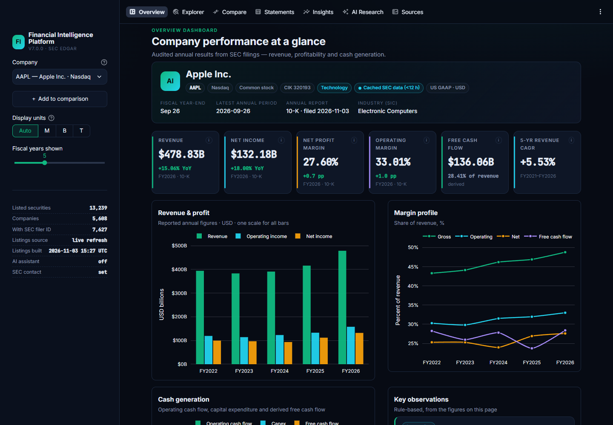

# Financial Intelligence Platform V7

**SEC-sourced fundamentals for every US-listed company: transparent analytics and a free-tier Gemini research assistant.**

V7 rebuilds the V6 Streamlit prototype into a production-quality financial research app:

- **13,000+ US exchange-listed securities** are searchable, rebuilt daily from official exchange directories. About 5,600 of them are operating companies.
- **Audited annual statements** come straight from SEC XBRL (10-K / 20-F / 40-F), with correct units, fiscal periods and filing links.
- **A premium dark UI** with KPI cards, shared-scale Plotly charts, statements, comparisons and rule-based insights.
- **A secure Gemini assistant.** The key stays server-side, only free-tier models are allowlisted, and abuse limits are enforced on the server.
- **A one-click Windows executable** and a ready-to-deploy Streamlit Community Cloud configuration.

> Educational research tool. It shows **reported annual financial statements**, not stock prices or real-time data, and it gives no investment advice.



---

## Contents
1. [What's inside](#whats-inside)
2. [Run it — three ways](#run-it--three-ways)
3. [Configure secrets (Gemini + SEC)](#configure-secrets-gemini--sec)
4. [Public deployment hardening](#public-deployment-hardening)
5. [Data sources and accuracy rules](#data-sources-and-accuracy-rules)
6. [Architecture](#architecture)
7. [Testing](#testing)
8. [Limitations](#limitations)

---

## What's inside

| Page | What it does |
|---|---|
| **Overview** | Company header (exchange, CIK, SIC sector, fiscal year-end, latest 10-K/20-F), six KPI cards with YoY deltas, revenue & profit bars, margin profile, cash generation, balance-sheet snapshot, and data-provenance chips. |
| **Explorer** | Ranked search by ticker or name across the full listing universe. `BRK.B`, `BRK-B` and `brkb` all work. Filters for exchange, instrument type (common stock, ADR, ETF, fund, preferred, warrant, unit, right, notes) and SIC-derived sector. Paginated results. |
| **Compare** | Up to 6 companies side by side, with automatic warnings for different currencies, fiscal year-ends and GAAP vs IFRS. Ratio and amount charts, multi-year trends, and a CSV export with full provenance. |
| **Statements** | Income statement, balance sheet, cash flow, ratios and an XBRL concept map. Derived and restated values are marked, and every table uses a single unit scale. |
| **Insights** | Rule-based observations, each labelled *Fact*, *Calculation* or *Flag*, with the rule and the fiscal year it rests on. Also includes the V6 **CSV upload analyzer** (now with a unit selector). |
| **AI Research** | Gemini answers grounded in a structured "fact pack" of SEC figures. Answers are split into facts, calculations, hypotheses and limitations, with `[AAPL FY2025 10-K]` citations. |
| **Sources** | Filing documents and indexes for each fiscal year used, Company Facts JSON, metric→concept definitions, formulas, timestamps and limitations. |

A display-unit selector (Auto/M/B/T) and a fiscal-years slider apply across the whole app.

---

## Run it — three ways

### A. Public web app (Streamlit Community Cloud) — no install for visitors
1. Push this folder to a GitHub repository. It is safe: `.streamlit/secrets.toml` is gitignored.
2. Go to <https://share.streamlit.io> → **Create app** → choose the repo, branch `main`, main file **`app.py`**.
3. Under **Advanced settings → Python version**, pick 3.12 (3.10–3.12 are tested).
4. Under **Advanced settings → Secrets**, paste the lines from [`.streamlit/secrets.toml.example`](.streamlit/secrets.toml.example) with your real values (see the next section).
5. Click **Deploy**. Visitors open the `https://<your-app>.streamlit.app` URL directly.

The deployment itself needs your GitHub and Streamlit accounts, so it has not been deployed from here. The exact steps above were checked with a clean-room install from `requirements.txt` plus a headless boot test (see `VERIFICATION_REPORT.md`).

### B. Windows desktop — one click
Download **`FinancialIntelligenceV7.exe`** and double-click it. There is no ZIP to extract, no Python, and no BAT file.
- It picks a free local port, starts the server on `127.0.0.1` only, and opens your default browser.
- Double-clicking again while it runs just reopens the browser tab (single instance).
- Close the small console window to stop the app.
- On first launch Windows SmartScreen may say *"Windows protected your PC"* because the file is unsigned. Click **More info → Run anyway**.
- If startup fails, the window prints troubleshooting steps, and details go to `%LOCALAPPDATA%\FinancialIntelligenceV7\launcher.log`.

To rebuild the exe yourself:
```bash
powershell -ExecutionPolicy Bypass -File desktop\build_windows.ps1
```
The script runs the tests first, then runs PyInstaller, then scans the exe for key-like strings. `.github/workflows/windows-build.yml` does the same on GitHub's Windows runners and attaches the exe to tagged releases.

### C. From source (developers)
```bash
python -m venv .venv
```
```bash
.venv\Scripts\pip install -r requirements-dev.txt
```
```bash
.venv\Scripts\python desktop\launcher.py
```
Or run `streamlit run app.py` from the project folder. Streamlit reads `.streamlit/` from the working directory.

---

## Configure secrets (Gemini + SEC)

| Setting | Required? | Purpose |
|---|---|---|
| `SEC_CONTACT_EMAIL` | Recommended | The SEC requires automated requests to identify a contact in the User-Agent. Without it, the app uses the bundled snapshots and asks visitors for an e-mail (session only). |
| `GEMINI_API_KEY` | Optional | Enables the AI assistant. Every other page works without it. |
| `AI_ACCESS_CODE`, `AI_*_LIMIT`, `AI_ENABLED` | Optional | Abuse protection for public sites (below). |

**Where to put them. Never paste your key into chat, the web page, GitHub or screenshots.**

| Where the app runs | Put the settings in |
|---|---|
| Local, from source | `.streamlit/secrets.toml`: copy `.streamlit/secrets.toml.example` and edit it (the file is gitignored). Environment variables with the same names also work and take precedence. |
| Windows exe | `%LOCALAPPDATA%\FinancialIntelligenceV7\config.toml`. The exe creates a commented template on first run; open it with Notepad, uncomment the lines, add your values and restart the app. |
| Streamlit Community Cloud | App → **Settings → Secrets**: paste the same `KEY = "value"` lines. |

**Getting a free Gemini key:** create one at <https://aistudio.google.com/apikey> in a Google Cloud project **with billing disabled**. Google decides billing by the project, not by the app. With billing off, requests can only use free-tier quota. The app also refuses to call any model that isn't on its free-tier allowlist: `gemini-3.5-flash-lite`, `gemini-3.1-flash-lite`, `gemini-2.5-flash-lite` and `gemini-3.6-flash`, checked against Google's pricing page on 2026-11-03.

> **Rotate the key you used in V6.** V6 had a key input box in the web page. If you ever pasted your key there on a shared or public deployment, create a new key in AI Studio and delete the old one.

How the key is protected:
- It is read only on the server (`fip/config.py`). No page has a key field.
- It is sent to Google only in the `x-goog-api-key` header, never in URLs, so it can't leak through logs or exception text.
- Error messages are built from status codes, never from response bodies. `showErrorDetails = "none"` hides stack traces from visitors.
- Tests check that a configured key never appears in rendered pages, and that the repo, release ZIP and exe contain no key-like strings.

---

## Public deployment hardening
A hidden key alone doesn't stop anonymous visitors from draining your quota, so all limits are enforced on the server and stored in SQLite (they survive reruns, new sessions and restarts):

| Control | Default | Setting |
|---|---|---|
| Questions per visitor (rolling 24 h) | 5 | `AI_CLIENT_DAILY_LIMIT` |
| Questions per site (rolling 24 h) | 100 | `AI_GLOBAL_DAILY_LIMIT` |
| Questions per minute (site) | 5 | `AI_GLOBAL_PER_MINUTE` |
| Cooldown per visitor | 20 s | `AI_COOLDOWN_SECONDS` |
| Invite-only access code (5 wrong tries/hour) | off | `AI_ACCESS_CODE` |
| Kill switch | on | `AI_ENABLED = false` |
| Answer cache (same question + same data) | 24 h | — |
| Question length / companies per question | 600 chars / 4 | — |

Visitors are identified by a salted hash of their IP, so raw IPs are never stored. `X-Forwarded-For` is ignored unless you set `AI_TRUST_PROXY_HEADERS = true` behind a proxy you control, because clients can forge that header. The global caps always apply. **For a public portfolio link, set `AI_ACCESS_CODE`** and share the code only with reviewers.

---

## Data sources and accuracy rules

| Source | Used for | Refresh |
|---|---|---|
| [Nasdaq Trader `nasdaqlisted.txt`](https://www.nasdaqtrader.com/dynamic/SymDir/nasdaqlisted.txt) / [`otherlisted.txt`](https://www.nasdaqtrader.com/dynamic/SymDir/otherlisted.txt) | Every security on Nasdaq, NYSE, NYSE American, NYSE Arca, Cboe BZX and IEX | Publisher: several times a day. App: every 24 h. Bundled snapshot: daily via GitHub Actions. |
| [SEC `company_tickers_exchange.json`](https://www.sec.gov/files/company_tickers_exchange.json) | Ticker → CIK (SEC registrant) | Same |
| SEC `submissions/CIK##########.json` | SIC industry, country, fiscal year-end, filing list and document links | Per company, cached 24 h. Sector snapshot is incremental. |
| SEC `api/xbrl/companyfacts/CIK##########.json` | Annual financial statements | On demand, cached 12 h |

The pipeline follows the SEC's fair-access rules: a contact User-Agent, a limit of 5 requests/s (the SEC allows 10), timeouts, and exponential backoff on 429/5xx that honours `Retry-After`. A 403 is never retried. Search never downloads financial data. Only the company you open is fetched.

**Accuracy rules** (enforced in `fip/xbrl.py`, regression-tested against real filings):
1. **Annual only.** Facts come from 10-K/10-KT/20-F/40-F (and amendments), and flow items must span 350–380 days, so quarterly or YTD values can't leak in.
2. **Fiscal years as the filer labels them.** Walmart's year ending 31 Jan 2025 is FY2025. The fiscal year-end, period dates and filing date are always shown separately.
3. **Values are stored in full currency units** exactly as filed (`416161000000`) and scaled only for display (`$416.16B`). The unit appears on every card, axis, table and CSV.
4. **One accounting basis and currency per company.** IFRS and US GAAP histories are not stitched together, USD convenience translations aren't used, and currencies are never converted. Comparisons warn when currencies, year-ends or bases differ.
5. **Revenue is the total-revenue concept** for each year, so insurers and banks aren't shown only contract revenue. The concept behind every value is recorded.
6. **Restatements:** the latest filed value is shown, flagged, and the original value is kept.
7. **Derived values are labelled:** free cash flow = OCF − capex; gross profit = revenue − cost of revenue when not reported; liabilities = (L+E) − equity, only when no non-controlling interest exists.
8. **Nothing is fabricated or borrowed.** Missing items show "—". Registrants without annual XBRL (e.g. ExxonMobil's new holding company, CIK 2115436, which so far has only 10-Q facts), ETFs, funds and unmapped listings get an explanation. No other entity's data is substituted.
9. **Fallbacks are always visible.** If the SEC is unreachable or blocks a cloud IP, the app shows stale cache or the bundled snapshot (53 large companies) with a banner giving the reason and the retrieval date.

---

## Architecture
```
app.py                    entry point: theme, sidebar, top navigation
views/                    7 pages (overview, explorer, compare, statements, insights, assistant, sources)
fip/
  config.py               server-side settings (env → Streamlit secrets); secrets never rendered
  http_client.py          SEC/Nasdaq HTTP: UA, rate limiter, retries/backoff, typed errors
  universe.py             listing universe: parse, classify, ticker↔CIK, search ranking
  sectors.py              SIC → sector mapping
  xbrl.py                 Company Facts → annual statements (rules above)
  metrics.py              growth, margins, CAGR, comparison tables & warnings
  insights.py             rule-based observations
  filings.py              submissions → profile + filing links
  data_service.py         fetch → validate → cache → fallback pipeline
  gemini.py               free-tier-only Gemini client + fact pack
  ai_guard.py             server-side quotas, cooldowns, access code, answer cache
  exports.py              CSV import/export (formula-injection safe)
  formatting.py           single formatting system for money/percent/pp/scales
  ui/                     theme tokens + CSS, components, charts, shared state
desktop/                  launcher.py, PyInstaller spec, build script, icon
scripts/                  data refresh, release packaging, browser E2E checks
data/                     bundled snapshots (universe, SEC profiles, 53 companies' statements)
tests/                    pytest suite (+ trimmed real SEC fixtures)
```
**Why Streamlit was kept:** version 1.65 provides top navigation, fuzzy select search, virtualized grids, `st.context.ip_address` and Google-font theming. With a custom design system on top, the UI goal was reachable without rewriting a working Python codebase into a separate JS frontend plus API. The trade-off is less pixel-level control than React. The custom CSS and components close most of that gap.

---

## Testing
```bash
.venv\Scripts\python -m pytest -q
```
There are 140+ tests, all offline. They cover unit formatting (including the spec examples), XBRL parsing edge cases, **real-filing regressions** (AAPL, MSFT, WMT, JPM, BRK.B, NVDA, TSM, TM, XOM), ticker mapping and search, HTTP retry and error handling, cache and snapshot fallbacks, Gemini failure and quota paths (mocked), the server-side AI guard, CSV import/export, secret-leakage scans, and headless rendering of all 7 pages.

Browser end-to-end check with real screenshots (needs Microsoft Edge):
```bash
.venv\Scripts\python scripts\e2e_browser_check.py http://localhost:8517 docs\screenshots
```

---

## Limitations
- XBRL Company Facts holds consolidated, non-dimensional facts only: no segments or geography.
- Some annual reports reach EDGAR before their statements reach Company Facts (TSMC FY2025, Toyota FY2026 at the time of writing). The app detects this and links to the filing.
- SIC-based sectors approximate modern sector schemes. Nasdaq Trader uses two undocumented exchange codes (`F`, `M`). The app labels these with SEC's exchange name rather than guessing.
- No market prices, market cap or valuation multiples: no free, licensed real-time source is used.
- The Gemini free tier's quotas are set by Google per project and can change. The assistant degrades gracefully when quota runs out.
- The Windows exe is unsigned. A code-signing certificate would remove the SmartScreen prompt.

See [CHANGELOG.md](CHANGELOG.md), [SECURITY.md](SECURITY.md) and [VERIFICATION_REPORT.md](VERIFICATION_REPORT.md).
