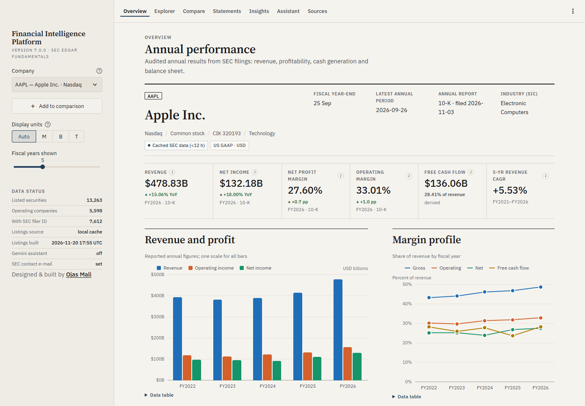

# Financial Intelligence Platform V7

**SEC-sourced fundamentals for every US-listed company: transparent analytics and a free-tier Gemini research assistant.**

*Designed & built by [Ojas Mali](https://github.com/ojxsmali).*

**Live web app → <https://financial-intelligence-v7.vercel.app>**

Two front ends share one Python data engine (`fip/`):
- **Web app** (`web/` + `fip/api.py`): React + TypeScript front end and a FastAPI JSON API, deployed together on **Vercel**.
- **Desktop app** (`app.py` + `views/`): the Streamlit version, shipped as a one-file Windows exe.

What it does:

- **13,000+ US exchange-listed securities** are searchable, rebuilt daily from official exchange directories. About 5,600 of them are operating companies.
- **Audited annual statements** come straight from SEC XBRL (10-K / 20-F / 40-F), with correct units, fiscal periods and filing links.
- **A research-note interface** — warm paper, ink and one navy accent, serif headings, tabular figures, hairline rules instead of cards, and accessible server-rendered charts (legend, keyboard tooltips, data-table alternative, colour-blind-validated palette). Responsive down to 320 px.
- **A secure Gemini assistant.** The key stays server-side, only free-tier models are allowlisted, and abuse limits are enforced on the server.
- **Deployed on Vercel** (static front end + Python serverless API), plus a one-click Windows executable.

> Educational research tool. It shows **reported annual financial statements**, not stock prices or real-time data, and it gives no investment advice.



---

## Contents
1. [What's inside](#whats-inside)
2. [Run it — three ways](#run-it--three-ways)
3. [Configure secrets (Gemini + SEC)](#configure-secrets-gemini--sec)
4. [Public deployment hardening](#public-deployment-hardening)
5. [Data sources and accuracy rules](#data-sources-and-accuracy-rules)
6. [Architecture](#architecture) · [Design decisions](#design-decisions-2026-11-redesign)
7. [Testing](#testing)
8. [Limitations](#limitations)

---

## What's inside

| Page | What it does |
|---|---|
| **Overview** | Company masthead (exchange, CIK, SIC sector, fiscal year-end, latest 10-K/20-F, data-provenance tag), a six-figure KPI strip with YoY deltas (▲/▼ + sign, never colour alone), revenue & profit bars, margin profile, cash generation, rule-based observations and a balance-sheet strip. |
| **Explorer** | Ranked search by ticker or name across the full listing universe. `BRK.B`, `BRK-B` and `brkb` all work. Filters for exchange, instrument type (common stock, ADR, ETF, fund, preferred, warrant, unit, right, notes) and SIC-derived sector. Paginated results. |
| **Compare** | Up to 6 companies side by side, with automatic warnings for different currencies, fiscal year-ends and GAAP vs IFRS. Ratio and amount charts, multi-year trends, and a CSV export with full provenance. |
| **Statements** | Income statement, balance sheet, cash flow, ratios and an XBRL concept map. Derived and restated values are marked, and every table uses a single unit scale. |
| **Insights** | Rule-based observations, each labelled *Fact*, *Calculation* or *Flag*, with the rule and the fiscal year it rests on. Also includes the V6 **CSV upload analyzer** (now with a unit selector). |
| **Assistant** | The only AI feature, clearly labelled as Gemini. Answers grounded in a structured "fact pack" of SEC figures. Answers are split into facts, calculations, hypotheses and limitations, with `[AAPL FY2025 10-K]` citations. |
| **Sources** | Filing documents and indexes for each fiscal year used, Company Facts JSON, metric→concept definitions, formulas, timestamps and limitations. |

A display-unit selector (Auto/M/B/T) and a fiscal-years selector apply across the whole app. In the web app the selected company lives in the URL (`?t=AAPL`), so every view is shareable.

---

## Run it

### A. Web app on Vercel
The repository is a ready Vercel project (`vercel.json`): Vercel builds `web/` into static files and serves `api/index.py` (FastAPI over `fip/`) as a Python function; `/api/*` is rewritten to the function and every other path to the single-page app.

1. On <https://vercel.com/new>, import `ojxsmali/financial-intelligence-v7` (no framework preset needed; settings come from `vercel.json`).
2. Under **Environment Variables**, add `SEC_CONTACT_EMAIL` (required for live SEC data) and, optionally, `GEMINI_API_KEY` and the `AI_*` limits below. Type these into Vercel yourself — never into the web page or the repo.
3. Deploy. Every push to `main` redeploys automatically.

Notes for Vercel:
- Function caches (SEC responses, the AI guard's SQLite) live in `/tmp`, so they are per instance and reset on cold starts. API responses are also cached at Vercel's edge (`s-maxage=1800`). For a public link, set `AI_ACCESS_CODE` so the shared Gemini quota can't be drained.
- On Vercel the listing universe comes from the bundled `data/universe.csv` (refreshed in the repo), so cold starts stay fast.
- Without `SEC_CONTACT_EMAIL`, companies in the bundled snapshot still work and visitors can supply a contact e-mail for their own browser session.

### B. Windows desktop — one click
Download **`FinancialIntelligenceV7.exe`** and double-click it. There is no ZIP to extract, no Python, and no BAT file.
- It picks a free local port, starts the server on `127.0.0.1` only, and opens your default browser.
- Double-clicking again while it runs just reopens the browser tab (single instance).
- Close the small console window to stop the app.
- On first launch Windows SmartScreen may say *"Windows protected your PC"* because the file is unsigned. Click **More info → Run anyway**.
- If startup fails, the window prints troubleshooting steps, and details go to `%LOCALAPPDATA%\FinancialIntelligenceV7\launcher.log`.

To rebuild the exe yourself:
```bash
powershell -ExecutionPolicy Bypass -File desktop\build_windows.ps1
```
The script runs the tests first, then runs PyInstaller, then scans the exe for key-like strings. `.github/workflows/windows-build.yml` does the same on GitHub's Windows runners and attaches the exe to tagged releases.

### C. From source (developers)
```bash
python -m venv .venv
```
```bash
.venv\Scripts\pip install -r requirements-dev.txt
```
Web app — run the API and the front end (Vite proxies `/api` to port 8531):
```bash
.venv\Scripts\python scripts\dev_api.py --port 8531
```
```bash
npm install --prefix web
```
```bash
npm run dev --prefix web
```
Then open <http://localhost:5190>.

Desktop (Streamlit) version:
```bash
.venv\Scripts\python desktop\launcher.py
```

Dependency files: `requirements.txt` is the core + API (what Vercel installs), `requirements-streamlit.txt` adds Streamlit, `requirements-dev.txt` adds test and build tools.

Configuration: copy `.env.example` to `.env` (gitignored) and fill in `SEC_CONTACT_EMAIL` and, optionally, `GEMINI_API_KEY`. The app loads `.env` at start-up without overriding real environment variables.

---

## Configure secrets (Gemini + SEC)

| Setting | Required? | Purpose |
|---|---|---|
| `SEC_CONTACT_EMAIL` | Recommended | The SEC requires automated requests to identify a contact in the User-Agent. Without it, the app uses the bundled snapshots and asks visitors for an e-mail (session only). |
| `GEMINI_API_KEY` | Optional | Enables the AI assistant. Every other page works without it. |
| `AI_ACCESS_CODE`, `AI_*_LIMIT`, `AI_ENABLED` | Optional | Abuse protection for public sites (below). |

**Where to put them. Never paste your key into chat, the web page, GitHub or screenshots.**

| Where the app runs | Put the settings in |
|---|---|
| Local, from source | `.env`: copy [`.env.example`](.env.example) (gitignored). Or `.streamlit/secrets.toml` from `.streamlit/secrets.toml.example`. Real environment variables take precedence over both. |
| Windows exe | `%LOCALAPPDATA%\FinancialIntelligenceV7\config.toml`. The exe creates a commented template on first run; open it with Notepad, uncomment the lines, add your values and restart the app. |
| Vercel (web app) | Project → **Settings → Environment Variables**: `SEC_CONTACT_EMAIL`, `GEMINI_API_KEY`, optional `AI_*`. |

**Getting a free Gemini key:** create one at <https://aistudio.google.com/apikey> in a Google Cloud project **with billing disabled**. Google decides billing by the project, not by the app. With billing off, requests can only use free-tier quota. The app also refuses to call any model that isn't on its free-tier allowlist: `gemini-3.5-flash-lite`, `gemini-3.1-flash-lite`, `gemini-2.5-flash-lite` and `gemini-3.6-flash`, checked against Google's pricing page on 2026-11-03.

> **Rotate the key you used in V6.** V6 had a key input box in the web page. If you ever pasted your key there on a shared or public deployment, create a new key in AI Studio and delete the old one.

How the key is protected:
- It is read only on the server (`fip/config.py`). No page has a key field.
- It is sent to Google only in the `x-goog-api-key` header, never in URLs, so it can't leak through logs or exception text.
- Error messages are built from status codes, never from response bodies. `showErrorDetails = "none"` hides stack traces from visitors.
- Tests check that a configured key never appears in rendered pages, and that the repo, release ZIP and exe contain no key-like strings.

---

## Public deployment hardening
A hidden key alone doesn't stop anonymous visitors from draining your quota, so all limits are enforced on the server and stored in SQLite (they survive reruns, new sessions and restarts):

| Control | Default | Setting |
|---|---|---|
| Questions per visitor (rolling 24 h) | 5 | `AI_CLIENT_DAILY_LIMIT` |
| Questions per site (rolling 24 h) | 100 | `AI_GLOBAL_DAILY_LIMIT` |
| Questions per minute (site) | 5 | `AI_GLOBAL_PER_MINUTE` |
| Cooldown per visitor | 20 s | `AI_COOLDOWN_SECONDS` |
| Invite-only access code (5 wrong tries/hour) | off | `AI_ACCESS_CODE` |
| Kill switch | on | `AI_ENABLED = false` |
| Answer cache (same question + same data) | 24 h | — |
| Question length / companies per question | 600 chars / 4 | — |

Visitors are identified by a salted hash of their IP, so raw IPs are never stored. `X-Forwarded-For` is ignored unless you set `AI_TRUST_PROXY_HEADERS = true` behind a proxy you control, because clients can forge that header. The global caps always apply. **For a public portfolio link, set `AI_ACCESS_CODE`** and share the code only with reviewers.

---

## Data sources and accuracy rules

| Source | Used for | Refresh |
|---|---|---|
| [Nasdaq Trader `nasdaqlisted.txt`](https://www.nasdaqtrader.com/dynamic/SymDir/nasdaqlisted.txt) / [`otherlisted.txt`](https://www.nasdaqtrader.com/dynamic/SymDir/otherlisted.txt) | Every security on Nasdaq, NYSE, NYSE American, NYSE Arca, Cboe BZX and IEX | Publisher: several times a day. App: every 24 h. Bundled snapshot: daily via GitHub Actions. |
| [SEC `company_tickers_exchange.json`](https://www.sec.gov/files/company_tickers_exchange.json) | Ticker → CIK (SEC registrant) | Same |
| SEC `submissions/CIK##########.json` | SIC industry, country, fiscal year-end, filing list and document links | Per company, cached 24 h. Sector snapshot is incremental. |
| SEC `api/xbrl/companyfacts/CIK##########.json` | Annual financial statements | On demand, cached 12 h |

The pipeline follows the SEC's fair-access rules: a contact User-Agent, a limit of 5 requests/s (the SEC allows 10), timeouts, and exponential backoff on 429/5xx that honours `Retry-After`. A 403 is never retried. Search never downloads financial data. Only the company you open is fetched.

**Accuracy rules** (enforced in `fip/xbrl.py`, regression-tested against real filings):
1. **Annual only.** Facts come from 10-K/10-KT/20-F/40-F (and amendments), and flow items must span 350–380 days, so quarterly or YTD values can't leak in.
2. **Fiscal years as the filer labels them.** Walmart's year ending 31 Jan 2025 is FY2025. The fiscal year-end, period dates and filing date are always shown separately.
3. **Values are stored in full currency units** exactly as filed (`416161000000`) and scaled only for display (`$416.16B`). The unit appears on every card, axis, table and CSV.
4. **One accounting basis and currency per company.** IFRS and US GAAP histories are not stitched together, USD convenience translations aren't used, and currencies are never converted. Comparisons warn when currencies, year-ends or bases differ.
5. **Revenue is the total-revenue concept** for each year, so insurers and banks aren't shown only contract revenue. The concept behind every value is recorded.
6. **Restatements:** the latest filed value is shown, flagged, and the original value is kept.
7. **Derived values are labelled:** free cash flow = OCF − capex; gross profit = revenue − cost of revenue when not reported; liabilities = (L+E) − equity, only when no non-controlling interest exists.
8. **Nothing is fabricated or borrowed.** Missing items show "—". Registrants without annual XBRL (e.g. ExxonMobil's new holding company, CIK 2115436, which so far has only 10-Q facts), ETFs, funds and unmapped listings get an explanation. No other entity's data is substituted.
9. **Fallbacks are always visible.** If the SEC is unreachable or blocks a cloud IP, the app shows stale cache or the bundled snapshot (53 large companies) with a banner giving the reason and the retrieval date.

---

## Architecture
```
web/                      React + TypeScript web app (Vite): pages/, components/ (charts, combobox, tabs), lib/ (format, api)
api/index.py              Vercel Python function entry → fip.api
app.py, views/            Streamlit desktop app: entry point + 7 pages
fip/
  config.py               server-side settings (env → Streamlit secrets); secrets never rendered
  http_client.py          SEC/Nasdaq HTTP: UA, rate limiter, retries/backoff, typed errors
  universe.py             listing universe: parse, classify, ticker↔CIK, search ranking
  sectors.py              SIC → sector mapping
  xbrl.py                 Company Facts → annual statements (rules above)
  metrics.py              growth, margins, CAGR, comparison tables & warnings
  insights.py             rule-based observations
  filings.py              submissions → profile + filing links
  data_service.py         fetch → validate → cache → fallback pipeline
  gemini.py               free-tier-only Gemini client + fact pack
  ai_guard.py             server-side quotas, cooldowns, access code, answer cache
  exports.py              CSV import/export (formula-injection safe)
  formatting.py           single formatting system for money/percent/pp/scales
  api.py                  FastAPI JSON API for the web app (company, search, compare, exports, upload, assistant)
  ui/                     Streamlit theme tokens + CSS, components, HTML/SVG charts, shared state
desktop/                  launcher.py, PyInstaller spec, build script, icon
scripts/                  data refresh, release packaging, browser E2E checks
data/                     bundled snapshots (universe, SEC profiles, 53 companies' statements)
tests/                    pytest suite (+ trimmed real SEC fixtures)
```
## Design decisions (2026-11 redesign)

The full pre-redesign review is in [docs/REVIEW.md](docs/REVIEW.md).

**Stayed on Streamlit, replaced the presentation layer.** The server-side Gemini key model, the AI guard, the Streamlit Cloud deploy path, the one-file exe and the AppTest page suite all depend on Streamlit; a separate JS frontend would have needed a new API, a second host and a new launcher. What made the old UI look generic was Plotly defaults and card-everything CSS — both replaceable.

- **Identity: a printed equity-research note.** Paper `#F5F3EE`, ink `#16181B`, one navy accent `#1D3B5A`. Structure comes from hairline rules and a heavy rule above each section, not from boxes. No gradients, glows or emoji.
- **Type.** Source Serif 4 for headings (editorial, readable at display sizes); IBM Plex Sans for UI and numbers, with `tabular-nums` so columns of figures align; IBM Plex Mono for tickers, XBRL concepts and formulas.
- **Tokens** live in `fip/ui/theme.py` (`TOKENS`, `SERIES`) and are mirrored into Streamlit's own theme in `.streamlit/config.toml`, so native widgets and custom HTML share one palette.
- **Charts** (`fip/ui/charts.py`) are server-rendered HTML + SVG instead of Plotly: one scale per chart stated in the header, straight segments between fiscal years (the old spline smoothing implied intra-year data), a legend for 2+ series, a per-year tooltip that opens on hover *and* keyboard focus, and a "Data table" disclosure with the exact values. The six series colours were checked with a colour-vision-deficiency validator (protan/deutan/tritan ΔE, ≥ 3:1 contrast) and are assigned in fixed order; on Compare each company keeps its colour across every chart.
- **Honest labelling.** Rule-based insights say "not AI-generated"; the Assistant page is the only AI feature and names Gemini. Derived values (free cash flow, restated figures) are marked.
- **States.** Loading uses a skeleton with a live "Loading annual filings…" status; empty and error states explain *why* (ETF, no XBRL, SEC unreachable) and what to do next; fallback data is tagged on the masthead.
- **Responsive & accessible.** Layout reflows to one column on phones; a scrollable page row keeps all pages one tap away on mobile (Streamlit folds its top nav into the drawer). Tables use row/column headers and scroll inside their own region; focus rings are visible; `prefers-reduced-motion` disables the skeleton pulse.
- **Trade-off.** Streamlit still owns widget internals and reruns, so a few rules target its `data-testid` hooks; Streamlit is pinned `<2.0` for that reason.

Designed & built by [Ojas Mali](https://github.com/ojxsmali).

---

## Testing
```bash
.venv\Scripts\python -m pytest -q
```
There are 171 Python tests, all offline (including 11 for the JSON API). They cover unit formatting (including the spec examples), XBRL parsing edge cases, **real-filing regressions** (AAPL, MSFT, WMT, JPM, BRK.B, NVDA, TSM, TM, XOM), ticker mapping and search, HTTP retry and error handling, cache and snapshot fallbacks, Gemini failure and quota paths (mocked), the server-side AI guard, CSV import/export, secret-leakage scans, `.env` loading, the chart builders (scales, negative values, gaps, escaping, accessibility hooks), and headless rendering of all 7 pages.

Web app tests (formatting parity with the Python rules, axis maths, CSV formula-injection safety, Markdown rendering without raw HTML, chart accessibility):
```bash
npm test --prefix web
```

Browser end-to-end check of the Streamlit app with real screenshots (needs Microsoft Edge):
```bash
.venv\Scripts\python scripts\e2e_browser_check.py http://localhost:8517 docs\screenshots
```

---

## Limitations
- XBRL Company Facts holds consolidated, non-dimensional facts only: no segments or geography.
- Some annual reports reach EDGAR before their statements reach Company Facts (TSMC FY2025, Toyota FY2026 at the time of writing). The app detects this and links to the filing.
- SIC-based sectors approximate modern sector schemes. Nasdaq Trader uses two undocumented exchange codes (`F`, `M`). The app labels these with SEC's exchange name rather than guessing.
- No market prices, market cap or valuation multiples: no free, licensed real-time source is used.
- The Gemini free tier's quotas are set by Google per project and can change. The assistant degrades gracefully when quota runs out.
- The Windows exe is unsigned. A code-signing certificate would remove the SmartScreen prompt.

See [CHANGELOG.md](CHANGELOG.md), [SECURITY.md](SECURITY.md) and [VERIFICATION_REPORT.md](VERIFICATION_REPORT.md).
